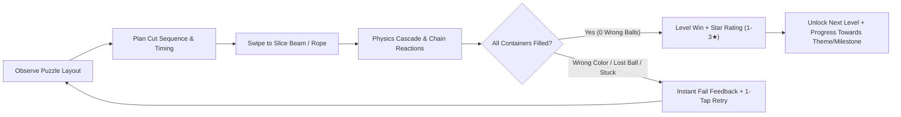
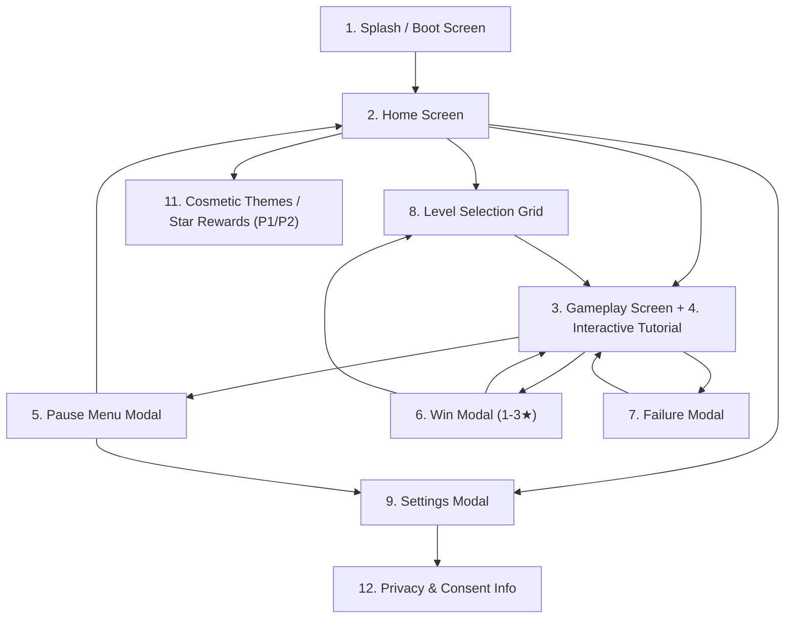

# CUT & CASCADE: COLOR PUZZLE — COMMERCIAL GAME DESIGN SPECIFICATION

**Engine Target:** Godot 4.7.2 (GDScript, Mobile Renderer)  
**Primary Launch Platform:** Android (Portrait), followed by iOS (Portrait)  
**Target Markets:** Tier-1 English-speaking markets (United States, Australia, United Kingdom, Canada) + global offline-first reach  
**Document Status:** Specification Only — Awaiting Stakeholder Approval

---

## 1. Executive Vision & Core Pillars

**Cut & Cascade: Color Puzzle** is a tactile, physics-driven 2D color-routing puzzle game built for one-handed portrait mobile play. Players slice wooden/laser support beams and braided tension ropes in deliberate sequences to release colored spheres (`RED`, `BLUE`, `YELLOW`, `GREEN`) and heavy `STEEL` strikers through kinetic contraptions into matching colored containers.

### Core Design Pillars
1. **Tactile Slice Satisfaction:** Every cut must feel immediately physical—combining responsive touch-line intersection, glowing blade trails, shockwave flashes, split-piece debris, synthesized multi-layered audio, and crisp micro-haptics.
2. **Readable Kinetic Causality:** Players must be able to look at a puzzle before making a single cut and trace *why* a ball will roll, bounce, trigger a switch, or land in a specific container. Failure must always feel fair and diagnosable, never random.
3. **Zero-Friction Flow (Offline-First):** Instant level restarts (`< 150 ms`), no mandatory internet connection, no energy timers gating normal play, and invalid swipes across empty space never penalize the player.
4. **Depth Through Combinatorics, Not Clutter:** Rather than bloating the screen with dozens of tiny objects, complexity emerges from timing, cut order, color-sorting gates, chain-reaction switches, and multi-cut skill shots.

---

## 2. Complete Game Design Document (GDD)

### 2.1 Core Gameplay Loop & Player Objectives



- **Primary Objective (1★):** Fill every `ColorContainer` in the level to its `required_count` using only balls of the matching `ColorType`.
- **Efficiency Objective (2★):** Complete the level within `par_moves + 1` valid cut gestures.
- **Mastery Objective (3★):** Complete the level within `par_moves` valid cut gestures (often requiring a single swipe that slices two aligned ropes/beams simultaneously or precise timing).

### 2.2 Exact Cutting Rules & Input Mechanics

1. **Valid vs. Invalid Swipes:**
   - A **Swipe Gesture** begins on `InputEventScreenTouch` (pressed) or `InputEventMouseButton` (left pressed) below the top HUD safe boundary (`world_y >= 122.0`) and continues through drag/motion events until release.
   - **Segment Intersection:** Each frame during a drag, segment `(last_world_pos, current_world_pos)` is tested against all uncut nodes in group `"cuttables"`.
     - For `CuttableBeam`: exact segment intersection with the beam centerline OR closest segment-to-segment distance `<= max(thickness * 0.95, 13.0)` px.
     - For `CuttableRope`: exact segment intersection with the taut rope segment `(anchor_global, end_global)` OR closest segment-to-segment distance `<= 14.0` px.
   - **Move Consumption Rule:**
     - Swiping through empty air, across static ramps, or across already-cut objects is an **Invalid Swipe**. It renders a cool cyan feedback trail (`Color(0.22, 0.86, 1.0)`) and **consumes 0 moves**.
     - The moment a swipe gesture slices its *first* uncut `CuttableBase`, that gesture becomes a **Valid Move**, incrementing `moves_used` by exactly `1` and shifting the blade trail to fiery gold (`Color(1.0, 0.92, 0.35)`).
     - **Skill Multi-Cut:** If the player continues dragging in the *same* continuous finger stroke (up to a maximum stroke length of `480 px` or `0.35 s` active cut window) and slices a second or third uncut object, those additional cuts belong to the **same move** (`moves_used` still increments by only `1`), triggering a `"MULTI-CUT!"` floating callout.
2. **Uncuttable Guard Objects:**
   - Chains/steel tethers (introduced in Chapter 3) and static ramps cannot be sliced; swiping across them produces a metallic spark deflection effect without consuming a move.

### 2.3 Physics Behavior & Determinism Rules

- **Coordinate Space:** Fixed virtual puzzle arena of `720 x 1280` units (`x = 18..702` interior width between side walls; `y = 126..1220` vertical playfield).
- **Gravity:** `980.0 px/s²` downward (`Vector2(0, 980)`), fixed physics tick rate of `60 Hz` (`physics/common/physics_ticks_per_second = 60`).
- **Pre-Cut Stability Guarantee:**
  - Rope-suspended bodies use `RigidBody2D.FREEZE_MODE_KINEMATIC` (`freeze = true`) until their attached `CuttableRope` is sliced, preventing pre-cut pendulum drift from causing timing inconsistency across devices.
  - Whenever any `CuttableBase` is cut or any `ChainTrigger` activates, all uncollected, unfrozen `PuzzleBall` bodies are explicitly woken (`sleeping = false`) and receive a micro-wake impulse (`Vector2(0, 2.0)`) so resting contacts re-evaluate on the very next physics step.

### 2.4 Win, Failure & Scoring Conditions

| Outcome | Trigger Condition | Immediate Feedback | Delay Before Modal |
| :--- | :--- | :--- | :--- |
| **WIN** | Every `ColorContainer` in `containers` has `collected_count >= required_count` and `is_finished == false`. | Confetti burst (`CPUParticles2D`), container glow, major chord fanfare, star calculation. | `0.55 s` (lets player enjoy confetti & final ball absorption) |
| **FAIL: Wrong Color** | A colored `PuzzleBall` (`RED`, `BLUE`, `YELLOW`, `GREEN`) enters a `ColorContainer` whose `color_type` does not match. | Red error particle burst, container red flash, screen shake (`12.0 px`), `"WRONG COLOR!"` floating text, buzz SFX. | `0.45 s` |
| **FAIL: Out of Bounds** | A colored `PuzzleBall` falls below `y > 1255.0` when at least one container of that color is not yet satisfied. (`STEEL` balls falling below `1255.0` are safely despawned without failing.) | Red upward warning flare at bottom edge, `"BALL LOST!"` floating text, screen shake (`8.0 px`), buzz SFX. | `0.35 s` |
| **FAIL: Balls Stuck / Incomplete** | All cuttable objects are cut (or `moves_used >= max_moves`) and all remaining uncollected colored balls have `linear_velocity.length() <= 14.0` continuously for `3.2 s` while containers remain unfilled. | `"STUCK!"` floating callout on stalled ball, gentle fail tone. | Immediate upon `3.2 s` timer expiry |
| **FAIL: Hazard Destroyer** | *(Chapter 4+ mechanic)* A colored ball contacts a Laser/Crusher hazard. | Ball shatter particles, `"DESTROYED!"` callout, screen shake. | `0.40 s` |

#### Star Rating Formula
Each level defines `par_moves: int` (the intended optimal number of swipe gestures):
- **3 Stars (`★★★`):** Level won with `moves_used <= par_moves`.
- **2 Stars (`★★☆`):** Level won with `moves_used == par_moves + 1`.
- **1 Star (`★☆☆`):** Level won with `moves_used >= par_moves + 2`.

### 2.5 Ball Types & Unique Properties

| Ball Type | Enum ID | Radius | Mass | Gravity Scale | Bounce / Friction | Special Behavior |
| :--- | :--- | :--- | :--- | :--- | :--- | :--- |
| **Red Ball** | `ColorType.RED` (0) | `18.0 px` | `1.0` | `1.0` | `0.22` / `0.04` | Collected only by `RED` containers. Emblem: Twin Arcs. |
| **Blue Ball** | `ColorType.BLUE` (1) | `18.0 px` | `1.0` | `1.0` | `0.22` / `0.04` | Collected only by `BLUE` containers. Emblem: Diamond. |
| **Yellow Ball** | `ColorType.YELLOW` (2) | `18.0 px` | `1.0` | `1.0` | `0.22` / `0.04` | Collected only by `YELLOW` containers. Emblem: 4-Point Star. |
| **Green Ball** | `ColorType.GREEN` (3) | `18.0 px` | `1.0` | `1.0` | `0.22` / `0.04` | Collected only by `GREEN` containers. Emblem: Triangle. |
| **Steel Striker** | `ColorType.STEEL` (4) | `20.0–24.0 px` | `4.5` | `1.15` | `0.15` / `0.03` | Heavy kinetic activator. Ignored by `ColorContainer` sensors (or consumed by `ChainTrigger`). Pushes lighter balls out of the way and triggers switches. Emblem: 4-Rivet Gear. |
| **Chameleon / Paintable Ball** *(P1, Lvl 31+)* | `ColorType.NEUTRAL` (5) | `18.0 px` | `1.0` | `1.0` | `0.22` / `0.04` | Starts pearl-white; adopts the `ColorType` of any `ColorDyeGate` it passes through before reaching a container. |

### 2.6 Ropes, Beams, Ramps, Switches & Obstacles

1. **`CuttableBeam` (Support Barrier):**
   - Static rectangular collider (`thickness = 14.0 px`, variable `length` and `rotation_degrees`).
   - Holds balls on angled ramps or seals vertical drop chutes. When cut or broken by a `ChainTrigger`, disables collision immediately and animates two falling half-beams.
2. **`CuttableRope` (Tension Tether):**
   - Connects a ceiling/wall anchor to a `RigidBody2D` (either a colored `PuzzleBall` or a `STEEL` striker).
   - Supports an optional `release_impulse: Vector2` applied at the instant of slicing for directional swing launches.
3. **`Ramp` (Static & Kinematic Chute):**
   - Rounded-cap surface (`StaticBody2D`) with low friction (`0.02`), configurable `bounce_amount` (`0.08` standard; `0.75` when configured as a **Bounce Pad**), and optional `left_lip_height` / `right_lip_height` backstops.
   - Can rotate smoothly (`rotate_to_degrees`) or slide (`move_to_position`) when linked to a `ChainTrigger`.
4. **`ChainTrigger` (Impact Switch / Node):**
   - Circular `Area2D` sensor that activates when contacted by any `PuzzleBall`.
   - Draws dashed neon conduit lines to all linked `CuttableBeam`s (which it shatters on impact) and linked `Ramp`s (which it rotates to new angles on impact).
   - Optional `consume_striker_ball`: absorbs a `STEEL` striker ball upon impact so the striker does not clutter lower chutes.
5. **Additional Obstacles for 100-Level Progression (P1):**
   - **`BumperPin` (Lvl 11+):** Circular high-restitution (`bounce = 0.85`) peg that deflects falling balls and emits a musical chime.
   - **`ColorFilterGate` (Lvl 21+):** Translucent energy barrier that allows only balls of its matching `ColorType` to pass through (via collision mask/layer filtering per color) while deflecting all other colors.
   - **`ColorDyeRing` (Lvl 31+):** Ring sensor that repaints any ball passing through it to the ring's `ColorType` with a splash of particles.
   - **`SeesawBridge` (Lvl 41+):** Center-pivoted `Ramp` that tips based on ball impact or alternating pass-throughs (flips angle by `±20°` each time a ball crosses its pivot).
   - **`PortalPair` (Lvl 61+):** Linked entry/exit warp rings that teleport a ball while preserving its velocity vector magnitude.

### 2.7 Hint, Undo & Retry Systems
- **1-Tap Instant Retry:** Top-right HUD button (and `R` key on desktop) reloads the current level in `< 100 ms` with zero loading screen.
- **Numbered Cut-Order Hint System:**
  - Tapping the **Hint (`💡`)** button highlights numbered badges (`1`, `2`, `3`...) on every player-cuttable beam and rope, showing the exact sequence required to solve the puzzle.
  - Beams that are meant to be broken *automatically* by a `ChainTrigger` display a lightning bolt (`⚡`) badge instead of a number so the player knows *not* to slice them manually.

### 2.8 Accessibility & Touch Controls
- **Colorblind Accessibility (Mandatory P0):**
  - Every ball color has both a distinct high-contrast hue AND a distinct geometric inner emblem (`RED` = Double Arc, `BLUE` = Diamond, `YELLOW` = 4-Point Star, `GREEN` = Triangle, `STEEL` = 4-Rivet Gear).
  - Every `ColorContainer` displays both its matching color, the geometric emblem, and the explicit text label (`RED`, `BLUE`, `YELLOW`, `GREEN`).
- **One-Handed Mobile Ergonomics:**
  - Minimum touch grazing radius of `28 px` (`14 px` each side of a rope/beam centerline) so thumb swipes on small screens (`5.4"`–`6.1"`) never miss due to finger occlusion.
  - Top HUD buttons have a minimum touch target size of `48x48 px` (Google Material Design accessibility standard).

### 2.9 Retention & Replayability Beyond 5 Levels
To sustain engagement across 100+ levels without repetition:
1. **New Mechanic Every 10 Levels:** Chapters of 20 levels introduce a new toy/obstacle every 10 levels (First 10: pure mastery of the new toy; Next 10: combining the new toy with previous chapters' toys).
2. **Skill-Shot 3-Star Mastery:** Levels are designed so a cautious player can clear them in `par_moves + 1` cuts (earning 2★), while an observant player can line up a single diagonal swipe to cut two ropes at once or time a moving cascade to earn 3★.
3. **Star Chests & Cosmetic Unlocks:** Earning stars fills a persistent **Star Meter** (e.g., every 15★ unlocks a new **Blade Trail Style** or **Ball Material Theme**—completely offline).
4. **Daily Cascade Puzzle (P2):** Deterministic daily seeded puzzle playable offline using the device calendar date.

---

## 3. Level Design Specification (100-Level Framework)

### 3.1 Chapter & Difficulty Progression Structure

| Chapter | Levels | Difficulty Tier | Mechanics Introduced | Container Colors | Avg. Par Cuts |
| :--- | :--- | :--- | :--- | :--- | :--- |
| **Ch. 1: Foundations** | `1 – 20` | Onboarding & Easy | `CuttableBeam`, `CuttableRope`, `Ramp`, `ChainTrigger`, `STEEL` Striker, `BumperPin` (L11) | 2 to 4 Colors | `2 – 4` |
| **Ch. 2: Color Logic** | `21 – 40` | Medium | `ColorFilterGate` (L21), `ColorDyeRing` (L31), Crossover Chutes | 3 to 4 Colors | `3 – 5` |
| **Ch. 3: Kinetic Timing** | `41 – 60` | Medium-Hard | `SeesawBridge` (L41), Uncuttable Steel Chains (L51), Sequential Chain Reactions | 3 to 4 Colors | `3 – 6` |
| **Ch. 4: Spatial Warp** | `61 – 80` | Hard | `PortalPair` (L61), Timed/Moving Deflectors (L71) | 4 Colors | `4 – 6` |
| **Ch. 5: Grand Master** | `81 – 100` | Expert | Multi-Stage Rube Goldberg Cascades combining all mechanics | 4 Colors | `4 – 7` |

### 3.2 Anti-Repetition Design Rules
Every level in the 100-level catalog must obey these four rules:
1. **No Consecutive Topology Clones:** Level `N` and Level `N+1` may never share the same container order and upper ramp symmetry.
2. **Sawtooth Difficulty Pacing:** Within every 5-level block (`[1..5]`, `[6..10]`, etc.):
   - Level `5k + 1`: Mechanic introduction (approachable, low fail rate).
   - Level `5k + 2`: Spatial variation (cross-screen routing).
   - Level `5k + 3`: Timing or order-dependent puzzle (cutting in wrong order causes a wrong-color fail).
   - Level `5k + 4`: Multi-stream challenge (high ball count, 3–4 colors).
   - Level `5k + 5`: **Milestone Boss Cascade** followed by a breather level at `5k + 6`.
3. **Meaningful Wrong-Order Consequence:** From Level 6 onward, at least 70% of levels must contain at least one cut order or timing mistake that routes a ball into a mismatched container or out of bounds, ensuring puzzles require thought rather than blind frantic swiping.

### 3.3 Detailed Specifications for the First 20 Levels

| Lvl | Title | Colors & Counts | Primary Mechanics | Puzzle Solution & Order Logic | Par Moves |
| :--- | :--- | :--- | :--- | :--- | :--- |
| **1** | **Twin Cascades** *(Implemented)* | `RED x3`, `BLUE x2` | `CuttableBeam` x2, `CuttableRope` x1, Return Ramps | Interactive Tutorial level. Cut Left Red Beam (1), Center Red Rope (2), Right Blue Beam (3). Order-independent onboarding. | `3` |
| **2** | **Triple Streams** *(Implemented)* | `GREEN x2`, `YELLOW x2`, `RED x2` | `CuttableBeam` x2, `CuttableRope` x2, Funnel Walls | 3-lane sorting. Cut Green Beam (1), two center Yellow Ropes (2–3, or 1 multi-cut swipe!), and Red Beam (4). | `3` |
| **3** | **Chain Reaction** *(Implemented)* | `BLUE x3`, `YELLOW x3`, `STEEL x1` | `ChainTrigger` x1, `STEEL` Striker, Pivoting Ramps x2 | Cut top Steel Striker Rope (1) -> hits `ChainTrigger` -> shatters both upper gates and rotates both lower ramps into position. Cut lower Blue & Yellow ropes (2, 3). | `3` |
| **4** | **Four-Color Spectrum** *(Implemented)* | `RED x2`, `BLUE x2`, `YELLOW x2`, `GREEN x2` | All 4 Colors, 2 Beams, 4 Ropes | Full 4-container bottom row. Cut outer Red/Green beams and slice paired inner Blue/Yellow ropes with horizontal multi-cuts. | `4` |
| **5** | **Grand Cascade** *(Implemented)* | `RED x2`, `GREEN x2`, `BLUE x2`, `YELLOW x2`, `STEEL x2` | Dual `ChainTrigger`s, Dual `STEEL` Strikers, Rotating Funnels | Slice both upper Steel Striker ropes in 1 horizontal swipe (1) -> triggers both outer Red & Yellow cascades. Slice middle Green/Blue ropes (2) and lower Green/Blue ropes (3). | `3` |
| **6** | **Look Before You Cut** | `RED x2`, `BLUE x2` | Order-dependent pivoting bridge + `ChainTrigger` | **Order Puzzle:** Cutting the Red Beam *before* dropping the Steel Striker sends Red balls down an un-flipped bridge into the `BLUE` bucket (Fail!). Must cut Striker Rope (1) first to flip the bridge, then Red Beam (2), then Blue Beam (3). | `3` |
| **7** | **The Overpass** | `YELLOW x3`, `GREEN x2` | Crossing high/low trajectories | High fast ramp launches Yellow balls *over* a slow lower Green chute. Player cuts Green Beam (1), Yellow Beam (2), and suspended Yellow Rope (3). | `3` |
| **8** | **Decoy Support** | `RED x2`, `YELLOW x2` | Decoy `CuttableBeam` holding a hazard blocker | 3 beams exist, but cutting the center "trap" beam drops a `BLUE` ball into the `RED` container! Player must cut only the left and right beams (1, 2) and leave the trap beam uncut. | `2` |
| **9** | **Pendulum Launch** | `BLUE x2`, `GREEN x2`, `RED x2` | `CuttableRope` with lateral `release_impulse` | Suspended balls launch sideways onto angled chutes when cut. Teaches directional rope release. | `3` |
| **10** | **Double Relay** | `RED x3`, `BLUE x3`, `STEEL x2` | Two-stage sequential `ChainTrigger` relay | Cutting Rope 1 drops Striker A onto Trigger 1, which breaks Beam A releasing Striker B onto Trigger 2, rotating the master sorting funnel for Red & Blue streams! | `3` |
| **11** | **Pinball Bounce** | `YELLOW x3`, `BLUE x2` | Introduces `BumperPin` (high-bounce peg) | Balls drop onto angled `BumperPin`s that ricochet them across a gap into elevated containers. | `3` |
| **12** | **Zig-Zag Plinko** | `GREEN x3`, `RED x3` | Staggered `BumperPin` matrix + side gates | Left and right upper hoppers feed through a diamond bumper array separated by a central divider wall. | `3` |
| **13** | **Bridge Lock** | `BLUE x2`, `YELLOW x2`, `GREEN x2` | `ChainTrigger` locking/unlocking center lane | Green balls must enter the center bucket *before* the Steel Striker flips the center ramp to route Blue & Yellow balls outward. Strict `1 -> 2 -> 3` cut order! | `3` |
| **14** | **Twin Decoys** | `RED x2`, `BLUE x2`, `YELLOW x2` | 2 Trap Ropes holding mismatched balls | 6 ropes hang above 3 buckets; 4 hold matching balls, 2 hold mismatched decoy balls. Player uses diagonal swipes to slice only the 4 matching ropes. | `3` |
| **15** | **Ricochet Relay** | `RED x2`, `GREEN x2`, `BLUE x2`, `YELLOW x2` | `BumperPin` + `ChainTrigger` combo | A Steel Striker bounces off two `BumperPin`s to hit a side-mounted `ChainTrigger`, opening 4 synchronized color chutes. | `4` |
| **16** | **Split Second** | `RED x3`, `YELLOW x3` | Moving/timed cascade spacing | Cutting the upper Red beam starts a 3-ball train; after the Red balls clear the mid-screen junction, the player cuts the Yellow rope to flip the junction ramp for the Yellow train. | `3` |
| **17** | **Four-Way Cross** | `RED x2`, `BLUE x2`, `YELLOW x2`, `GREEN x2` | Alternating left/right chutes + 2 `ChainTrigger`s | Inner chutes cross over outer chutes using high-angle launch ramps and bumper cushions. | `4` |
| **18** | **The Gauntlet** | `BLUE x4`, `GREEN x4` | High-volume 8-ball stream + 3-stage ramp cascade | Tests multi-ball spacing and funnel flow with 4 balls per container. | `4` |
| **19** | **Precision Strike** | `RED x2`, `YELLOW x2`, `GREEN x2` | 1 Trap Trigger + 1 Safe Trigger | Two `ChainTrigger`s sit below two Steel Strikers: one rotates the ramp to the *wrong* angle (Fail), the other rotates it to the *winning* angle. Player must trace the dashed conduit lines before cutting! | `3` |
| **20** | **Chapter 1 Finale** | `RED x3`, `BLUE x3`, `YELLOW x2`, `GREEN x2` | 10 colored balls + 2 `STEEL` Strikers + `BumperPin`s + 2 `ChainTrigger`s | Grand synthesis of all Chapter 1 mechanics across 4 containers. | `4` |

### 3.4 Level Data Format Specification
To scale cleanly to 100+ levels while preserving the existing `LevelController` API, levels use a declarative `Dictionary` / `Resource` schema (`res://data/levels/level_XXX.tres` or `LevelCatalog` dictionary entries) consumed by `LevelData.populate_level()`:

```gdscript
# Canonical Level Definition Schema
{
	"level_id": 6,
	"chapter": 1,
	"title": "Level 6: Look Before You Cut",
	"subtitle": "Flip the bridge with the Steel Striker BEFORE releasing the Red balls!",
	"par_moves": 3,
	"containers": [
		{"pos": Vector2(210, 1060), "color": GameColors.ColorType.RED, "count": 2, "width": 136.0},
		{"pos": Vector2(510, 1060), "color": GameColors.ColorType.BLUE, "count": 2, "width": 136.0}
	],
	"ramps": [
		{"id": "r_upper_red", "pos": Vector2(160, 350), "len": 190.0, "angle": 18.0, "color": "RED", "left_lip": 48.0, "right_lip": 0.0},
		{"id": "r_bridge", "pos": Vector2(310, 620), "len": 230.0, "angle": 22.0, "color": "RED", "left_lip": 0.0, "right_lip": 80.0}
	],
	"beams": [
		{"id": "b_red", "pos": Vector2(256, 362), "len": 82.0, "angle": 108.0, "hint_order": 2, "hint_label": "2"}
	],
	"balls": [
		{"id": "striker_1", "pos": Vector2(520, 280), "color": GameColors.ColorType.STEEL, "radius": 22.0},
		{"id": "red_1", "pos": Vector2(120, 312), "color": GameColors.ColorType.RED, "radius": 18.0}
	],
	"ropes": [
		{"anchor": Vector2(520, 190), "ball_id": "striker_1", "offset": Vector2(0, 90), "impulse": Vector2.ZERO, "hint_order": 1, "hint_label": "1"}
	],
	"triggers": [
		{"pos": Vector2(520, 420), "radius": 28.0, "consume_steel": true, "break_beams": [], "rotate_ramps": [{"ramp_id": "r_bridge", "angle": -22.0}]}
	],
	"solution_steps": [
		{"delay": 0.25, "from": Vector2(470, 235), "to": Vector2(570, 235)},
		{"delay": 0.45, "from": Vector2(210, 362), "to": Vector2(300, 362)}
	]
}
```

---

## 4. Visual Design Specification

### 4.1 Visual Theme & Art Direction
- **Theme:** *"Luminous Kinetic Lab"* — Sleek dark-indigo cosmic workshop backdrop contrasted with high-saturation glossy candy/neon spheres, warm amber cuttable timber/energy beams, and glowing glass collection vessels.
- **No Human Faces or Characters:** The visual identity is 100% abstract, geometric, and physics-focused—maximizing universal cultural appeal across the US, Australia, Europe, and Asia while keeping asset memory footprint near zero.

### 4.2 Color Palette & Colorblind-Safe Contrast

| Element | Main Hex / RGB | Dark Rim Hex / RGB | Highlight Hex / RGB | Geometric Emblem |
| :--- | :--- | :--- | :--- | :--- |
| **Background Deep** | `#0F1424` `(0.06, 0.08, 0.14)` | `#080B14` `(0.03, 0.04, 0.08)` | `#243352` `(0.14, 0.20, 0.32)` | Subtle scrolling `60 px` grid |
| **Red (Crimson Coral)** | `#FF455C` `(1.00, 0.27, 0.36)` | `#9E1A2E` `(0.62, 0.10, 0.18)` | `#FFADB8` `(1.00, 0.68, 0.72)` | Twin Opposing Arcs |
| **Blue (Azure Sky)** | `#2E9EFF` `(0.18, 0.62, 1.00)` | `#124D9E` `(0.07, 0.30, 0.62)` | `#A8DBFF` `(0.66, 0.86, 1.00)` | Rotated Diamond |
| **Yellow (Solar Gold)** | `#FFD129` `(1.00, 0.82, 0.16)` | `#AD7A0A` `(0.68, 0.48, 0.04)` | `#FFF2AD` `(1.00, 0.95, 0.68)` | 4-Point Star |
| **Green (Emerald Mint)** | `#33E07A` `(0.20, 0.88, 0.48)` | `#147A3D` `(0.08, 0.48, 0.24)` | `#ADFAEB` `(0.68, 0.98, 0.80)` | Equilateral Triangle |
| **Steel (Titanium)** | `#9EADC7` `(0.62, 0.68, 0.78)` | `#525C70` `(0.32, 0.36, 0.44)` | `#DBE6F5` `(0.86, 0.90, 0.96)` | 4-Rivet Gear Ring |
| **Cuttable Amber** | `#F59E2E` `(0.96, 0.62, 0.18)` | `#8C4714` `(0.55, 0.28, 0.08)` | `#FFD66B` `(1.00, 0.84, 0.42)` | Diagonal stripes + scissor line |

### 4.3 Component & Effect Visuals
- **Balls (`PuzzleBall`):** 5-layer procedural vector draw: (1) world-space drop shadow offset `(0, 3 px)`, (2) dark outer border (`radius`), (3) vibrant main fill (`radius - 2.5 px`), (4) inner color-coded emblem that rotates with the ball's angular velocity, and (5) world-locked top-left specular highlights so the sphere looks 3D as it rolls.
- **Containers (`ColorContainer`):** Flared U-channel frame (`11 px` dark border + `6.5 px` neon core), translucent glass interior, animated rising liquid fill (`lerpf` with surface highlight line), animated downward funnel chevrons at the mouth, and a pulsing outer halo once `collected_count >= required_count`.
- **Cutting & Chain Reaction Effects:**
  - **Blade Trail:** Dual-pass polyline (`width + 6.0 px` outer glow + `width` core) tapering over `0.24 s`.
  - **Cut Shockwave:** Expanding ring (`8 px -> 38 px` over `0.28 s`) + directional cross-slash line + `18` gravity-affected spark particles.
  - **Chain Conduit:** Dashed neon line connecting each `ChainTrigger` to its target beams/ramps; pulses brighter and emits `22` cyan/gold sparks when triggered.

### 4.4 Audio & Haptic Feedback Direction
- **Procedural Audio Engine (`SfxManager`):** Zero-latency 16-bit `22050 Hz` synthesized `AudioStreamWAV` clips with pitch modulation:
  - **Beam Cut:** Crisp low-mid snap (`620 Hz -> 180 Hz`, `0.13 s` with noise transient).
  - **Rope Snip:** High taut string snap (`980 Hz -> 340 Hz`, `0.09 s`).
  - **Ball Collected:** Rising harmonic chime (`520 Hz -> 1040 Hz`), pitch-shifted upward by `+5%` per consecutive ball collected in the level (`0.95 + collected * 0.05`).
  - **Chain Trigger:** Electric power-up sweep (`310 Hz -> 740 Hz`, `0.22 s`).
  - **Win Fanfare:** 4-note major arpeggio (`C5 - E5 - G5 - C6`, staggered by `60 ms`).
  - **Background Ambient Loop (P1):** Optional procedural ambient pad (soft pentatonic synth drone at `-18 dB`) with independent `Music: ON/OFF` toggle.
- **Haptics:**
  - Slice impact: `22 ms` light crisp pulse (`Input.vibrate_handheld(22)`).
  - Chain reaction: `35 ms` medium pulse.
  - Level fail: `60 ms` warning buzz.
  - Controlled by a persistent `Vibration: ON/OFF` toggle in Settings.

---

## 5. Complete UI/UX Specification

### 5.1 Screen Flow & Navigation Architecture



### 5.2 Screen-by-Screen Specification

1. **Splash / Boot Screen (`0.6 s`):**
   - Displays game title logo (`CUT & CASCADE`), version badge, and initializes `SaveManager` + `SfxManager` streams. Automatically transitions into the Home Screen (or directly into Level 1 on first install).
2. **Home Screen:**
   - **Layout:** Animated background cascade preview + centered title emblem + large primary CTA button **`PLAY LEVEL N`** (`320 x 76 px`, emerald green) + secondary row with **`LEVELS`** (`Grid Icon`), **`THEMES`** (`Star Chest Icon`), and **`SETTINGS`** (`Gear Icon`).
   - **Top Bar:** Total Stars badge (`★ 14 / 300`).
3. **Gameplay Screen (HUD + Arena):**
   - **Top HUD Panel (`y = 12..118`):**
     - **Row 1:** Level Title (`Level 3: Chain Reaction`), Ball Progress Counter (`Balls: 4 / 6`), Moves Counter (`Cuts: 2 / 3`), **`Hint (💡)`** button, **`Restart (↻)`** button, and **`Pause (⏸)`** button.
     - **Row 2:** Concise 1-line objective subtitle + Quick Level Strip (`1..5` or chapter pager) with lock icons (`🔒`) on locked levels and earned star indicators (`★`) on completed levels.
   - **Playfield (`y = 126..1220`):** Unobstructed touch canvas for slicing.
4. **Interactive Gameplay Tutorial (Level 1):**
   - **No Modal Text Walls:** On Level 1, an animated glowing hand/scissor indicator (`TutorialGuide`) glides repeatedly across Cuttable Target `1` (`(200, 370) -> (290, 370)`) with a floating pill label `"SWIPE TO CUT"`.
   - As soon as Target `1` is sliced, the hand smoothly tweens to Target `2` (the suspended rope at `(155, 755) -> (255, 755)`), and then to Target `3` (`(430, 370) -> (520, 370)`).
   - Once all 3 targets are sliced, the tutorial overlay fades out and `SaveManager.tutorial_completed` is persisted as `true`.
5. **Pause Menu Modal:**
   - Triggered by the top-right `⏸` button, `ESC` key, or Android hardware Back button (`NOTIFICATION_WM_GO_BACK_REQUEST`).
   - Sets `get_tree().paused = true`.
   - **Buttons:** `Resume Game`, `Restart Level`, `Sound: ON/OFF`, `Volume: 100%/75%/50%/25%`, `Vibration: ON/OFF`, `Level Select`, and `Reset Progress`.
6. **Win Screen Modal:**
   - Appears `0.55 s` after the final container is satisfied.
   - Displays **`LEVEL COMPLETE!`**, animated 3-star bar (`★ ★ ★` popping in sequentially at `0.15 s` intervals), move summary (`Completed in 3 Cuts — Par: 3`), **`Next Level ▶`** primary CTA, and **`Replay`** secondary button.
7. **Failure Screen Modal:**
   - Appears on wrong-color collection, ball out-of-bounds, or stuck timeout.
   - Displays **`LEVEL FAILED`**, specific diagnostic reason (e.g., `"BLUE ball landed in RED container!"`), prominent **`Retry Level ↻`** primary CTA, and **`Show Hint 💡`** secondary button.
8. **Level Selection Screen:**
   - Scrollable grid of level cards (5 columns x 4 rows per Chapter tab), showing Level Number, Lock status (`🔒`), or earned Stars (`★☆☆` to `★★★`).
9. **Settings Modal:**
   - Sound Mute toggle, SFX Volume stepper (`25% / 50% / 75% / 100%`), Vibration toggle, Colorblind High-Contrast Emblem toggle (on by default), Privacy Policy link, and Reset Save Data button (with confirmation prompt).
10. **Rewards / Unlocks & Optional Cosmetic Shop (P1/P2):**
    - Displays unlockable Blade Trails (*Cyan Laser*, *Solar Flame*, *Rainbow Ribbon*, *Emerald Plasma*) unlocked via earned Stars (`15★`, `35★`, `60★`) or optional cosmetic purchase.
11. **Privacy & Consent Interface (P2):**
    - Displays Google UMP (User Messaging Platform) consent status and a `"Manage Privacy Preferences"` button required for EEA/UK/US-State (California CCPA/CPRA) compliance once ad SDKs are enabled.

### 5.3 Responsive Portrait Layout & Safe Areas (Android & iOS)

| Device Class | Aspect Ratio | Example Resolution | Viewport Mapping Strategy |
| :--- | :--- | :--- | :--- |
| **Standard 16:9 Phone** | `9:16` (`0.5625`) | `1080 x 1920` | Exact `1:1` match to `720 x 1280` design space. |
| **Modern Tall Android (19.5:9 – 20:9)** | `9:20` (`0.4500`) | `1080 x 2400` | `stretch/aspect = "expand"`: Virtual height expands to `~1600 px`; `_camera` centers the `720x1280` puzzle vertically while top HUD respects `DisplayServer.get_display_safe_area()` camera cutout/notch inset. |
| **Foldable / Tablet Portrait (4:3 – 3:4)** | `3:4` (`0.7500`) | `1536 x 2048` | `stretch/aspect = "expand"`: Virtual width expands to `~960 px`; `_camera` centers the `720x1280` puzzle horizontally (`offset.x`) while background grid fills full width. |

---

## 6. Monetization, ASO & Commercial Strategy

### 6.1 Player-Friendly Monetization Model (P2 — Disabled During Early Testing)

> [!IMPORTANT]
> Per project instructions, **no live ad SDKs, invented AdMob IDs, or payment SDKs are activated in early testing**. All monetization hooks are designed behind clean interfaces (`AdService`, `BillingService`) that default to offline no-op mode until you supply production credentials.

1. **Rewarded Video Ads (Player-Initiated Only):**
   - **Placement A — Free Hint Unlock:** When the player taps `Hint` and has 0 hint tokens remaining, they can watch a rewarded ad to reveal the numbered cut sequence for the current level (offline fallback: grants free hint on a 3-minute cooldown or costs earned stars).
   - **Placement B — Skip Tough Level:** After failing the same level `3` consecutive times, an optional `"Skip Level (Watch Ad)"` button appears on the Fail modal.
2. **Frequency-Capped Interstitial Ads:**
   - **Strict Protection Rules:**
     - **Zero interstitials** during the first `10` levels (protects Day-1 onboarding & tutorial completion).
     - **Minimum cooldown:** At least `180 seconds` of active gameplay AND at least `3` completed/retried levels between any two interstitials.
     - **Never before a cut:** Interstitials may only trigger *after* clicking `Next Level` on the Win modal—never mid-level or immediately on failure frustration.
3. **In-App Purchases (Google Play Billing / Apple StoreKit):**
   - **`remove_ads` (Non-Consumable, target \$2.99 USD / \$4.49 AUD):** Permanently disables all interstitial ads and grants unlimited Hints without watching rewarded ads.
   - **`supporter_cosmetic_pack` (Non-Consumable, target \$4.99 USD / \$7.49 AUD):** Includes `remove_ads` + exclusive *Supernova Blade Trail* and *Crystal Prism Ball Skin*.
   - **Restore Purchases Button:** Mandatory button in Settings (`Restore Purchases`) querying non-consumable entitlements on new device installs.
4. **Privacy, Child-Safety & Policy Compliance:**
   - Target audience: **General Audience (13+ / Mixed Audience Neutral Age Screen)** to avoid COPPA behavioral advertising restrictions, or if enrolled in Google Play Families Policy, ad requests must set `tag_for_child_directed_treatment = true` and `max_ad_content_rating = "G"`.
   - Google UMP SDK required prior to initializing AdMob in EEA/UK and US state privacy jurisdictions.

### 6.2 External Accounts & Credentials Requiring Your Involvement (Milestone M5/M6)
Before live commercial release, you will need to provide/configure:
1. **Google Play Console Developer Account** (\$25 one-time registration, identity verification, merchant payment profile for IAP).
2. **Release Upload Keystore (`.keystore` / `.jks`)** for signing Android App Bundles (`.aab`).
3. **Google AdMob Account** -> App ID (`ca-app-pub-XXXXXXXXXXXXXXXX~YYYYYYYYYY`) and Ad Unit IDs for `Rewarded` and `Interstitial` placements.
4. **Google Play In-App Product SKUs** configured in Play Console matching the game's billing catalog.
5. **Hosted Privacy Policy URL** (HTTPS webpage disclosing local storage, optional analytics, and ad SDK data usage).

### 6.3 App Store Optimization (ASO) & Marketing Strategy (US & Australia)

- **Working Title:** `Cut & Cascade: Color Puzzle` (27 chars — fits Google Play 30-char title limit)
- **Short Description (78 chars):** `Slice ropes & beams! Trigger chain reactions to drop balls into matching cups.`
- **Long Description Direction:**
  - *Hook:* "One swipe can start a chain reaction! Slice through wooden beams and taut ropes to guide vibrant cascading balls into their matching color containers."
  - *Feature Bullets:* Tactile swipe-to-cut physics; 100 handcrafted brain-teasing puzzles; satisfying chain reactions with steel strikers, pivoting bridges, and color gates; 100% playable offline anywhere—on a flight, commute, or couch.
- **Keyword Candidates (Hypotheses for ASO Testing — Not Guaranteed Volume Data):**
  - *Primary:* `cut puzzle`, `color ball sort`, `rope cut game`, `physics puzzle offline`, `chain reaction game`, `slice puzzle`, `drop ball puzzle`, `brain teaser offline`.
- **Icon & Screenshot Concepts:**
  - **App Icon:** High-contrast close-up of a glowing cyan blade slicing a golden rope, releasing a glossy Red and Blue ball toward glowing neon buckets against a deep indigo background.
  - **Screenshots (5 Portrait Cards):**
    1. *"Slice to Cascade!"* (Level 1 mid-slice with glowing spark trail)
    2. *"Trigger Epic Chain Reactions!"* (Level 3 Steel Striker hitting `ChainTrigger`)
    3. *"Sort All Four Colors!"* (Level 4 four-color spectrum cascade)
    4. *"Think Before You Cut!"* (Order-dependent puzzle showing `✓` vs `✗` path)
    5. *"Play 100% Offline Anywhere!"*
- **Store Conversion & UA Testing Hypotheses:**
  - *Hypothesis 1:* Showing a "Wrong Cut Order -> Fail" vs "Right Cut Order -> Win" split in the first 3 seconds of video creatives will improve Play Store install conversion rate (`CVR`) over static screenshots.

### 6.4 Commercial Success Metrics & Validation Targets (Hypotheses)

> [!NOTE]
> The following KPI targets are **internal validation hypotheses** used to decide when the game is ready to scale paid user acquisition in the US and Australia—not guaranteed industry results.

| Metric | Soft-Launch Validation Target (Hypothesis) | Scale-Ready Target (Hypothesis) | Measurement Point |
| :--- | :--- | :--- | :--- |
| **Tutorial Completion Rate (Level 1 Win)** | `>= 88%` | `>= 93%` | `level_won(1) / app_first_open` |
| **First-Session Length** | `>= 6.0 minutes` | `>= 9.0 minutes` | Median session duration on Day 0 |
| **Level 1–10 Completion Funnel** | `>= 65%` reach Level 10 | `>= 75%` reach Level 10 | Cohort progression funnel |
| **Day-1 Retention (D1)** | `>= 35%` | `>= 42%` | Return session 24–48h after install |
| **Day-7 Retention (D7)** | `>= 10%` | `>= 15%` | Return session on Day 7 |
| **Crash-Free Sessions** | `>= 99.2%` | `>= 99.6%` | Android Vitals / crash logger |
| **Store Listing Conversion (CVR)** | `>= 25%` | `>= 32%` | Google Play Store Listing Experiments |
