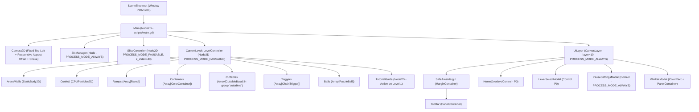

# CUT & CASCADE: COLOR PUZZLE — GODOT 4.7.2 TECHNICAL ARCHITECTURE

**Engine Version:** Godot 4.7.2-stable (Mobile Renderer, 2D GodotPhysics2D)  
**Primary Scripting Language:** Typed GDScript 2.0  
**Architecture Pattern:** Scene-Scoped Controllers + RefCounted Data Services + Decoupled Service Adapters

---

## 1. Project Folder Structure & Scene Hierarchy

### 1.1 Canonical Repository Layout
Reuses all existing working folders and extends cleanly without breaking existing resource paths:

```text
res://
├── project.godot                      # Godot 4.7.2 project config (720x1280 portrait)
├── icon.svg                           # Project vector icon
├── docs/                              # Commercial specifications & architecture docs
│   ├── GAME_DESIGN_SPEC.md
│   ├── TECHNICAL_ARCHITECTURE.md
│   └── IMPLEMENTATION_ROADMAP.md
├── scenes/
│   ├── main.tscn                      # Root application scene (Main controller + Camera2D + UILayer)
│   ├── components/                    # Reusable gameplay prefabs
│   │   ├── ball.tscn                  # PuzzleBall (RigidBody2D)
│   │   ├── container_bucket.tscn      # ColorContainer (Node2D + StaticBody2D + Area2D)
│   │   ├── cuttable_beam.tscn         # CuttableBeam (CuttableBase + StaticBody2D)
│   │   ├── cuttable_rope.tscn         # CuttableRope (CuttableBase + kinematic hold/release)
│   │   ├── ramp.tscn                  # Ramp (StaticBody2D + tweened rotation/translation)
│   │   ├── chain_trigger.tscn         # ChainTrigger (Area2D + linked beam/ramp conduits)
│   │   ├── bumper_pin.tscn            # (P1) High-restitution circular deflector peg
│   │   ├── color_filter_gate.tscn     # (P1) Color-selective pass-through barrier
│   │   └── tutorial_guide.tscn        # (P0) Animated hand/scissor swipe indicator for Level 1
│   └── levels/
│       ├── level_1.tscn .. level_5.tscn  # Standalone inspectable level scenes
├── scripts/
│   ├── main.gd                        # Root orchestrator, responsive camera, UI modals, state machine
│   ├── game_colors.gd                 # ColorType enum, colorblind-safe palettes & emblem helpers
│   ├── ball.gd                        # PuzzleBall physics & multi-layer procedural rendering
│   ├── container_bucket.gd            # ColorContainer collection sensor, liquid fill & match logic
│   ├── cuttable_base.gd               # Abstract base class for sliceable objects
│   ├── cuttable_beam.gd               # Sliceable support beam with split-piece animation
│   ├── cuttable_rope.gd               # Sliceable tether holding/releasing RigidBody2D payloads
│   ├── ramp.gd                        # Angled chute with end-caps, backstop lips & tween helpers
│   ├── chain_trigger.gd               # Impact sensor triggering beam cuts & ramp rotations
│   ├── slice_controller.gd            # Touch/mouse swipe input, segment intersection & move counting
│   ├── level_controller.gd            # Playfield lifecycle, win/fail evaluation, floating callouts
│   ├── level_data.gd                  # Level builder & declarative level catalog
│   ├── sfx_manager.gd                 # Procedural AudioStreamWAV synthesizer & pooled players
│   ├── save_manager.gd                # Atomic ConfigFile persistence, checksums & backup recovery
│   ├── tutorial_guide.gd              # (P0) Context-sensitive Level 1 swipe tutorial overlay
│   └── services/                      # (P2) Offline-safe service adapters
│       ├── analytics_service.gd       # Local event ring-buffer + optional telemetry hook
│       ├── ad_service.gd              # Rewarded/Interstitial state machine with offline fallback
│       └── billing_service.gd         # IAP entitlement manager with offline cache
└── tests/
    └── test_runner.gd                 # Headless automated verification & solvability test suite
```

### 1.2 Runtime Scene Tree Hierarchy



---

## 2. Script Responsibilities & Signal Architecture

### 2.1 Component Responsibility Matrix

| Script / Class | Base Type | Core Responsibility | Key Signals Emitted |
| :--- | :--- | :--- | :--- |
| `Main` (`main.gd`) | `Node2D` | Owns `SaveManager`, `SfxManager`, `SliceController`, active `LevelController`, responsive viewport centering, and all UI modals (HUD, Pause, Level Select, Win/Fail). | *(Top-level consumer)* |
| `LevelController` | `Node2D` | Instantiates puzzle elements from `LevelData`, tracks `moves_used` and `par_moves`, monitors ball out-of-bounds and settled timeouts, computes 1–3★ ratings. | `level_won(level_idx, stars, moves)`, `level_failed(level_idx, reason)`, `progress_updated(collected, required)`, `moves_updated(moves_used, par_moves)`, `cut_made(item, pt)`, `chain_reaction_triggered()` |
| `SliceController` | `Node2D` | Converts screen touch/mouse coordinates to world space, performs segment-vs-cuttable intersection, distinguishes valid moves from invalid swipes, renders blade trail & cut shockwaves. | `object_sliced(item, cut_point, cuts_in_swipe)`, `valid_move_performed(total_cuts_in_move)`, `invalid_swipe_performed()` |
| `CuttableBase` / `CuttableBeam` / `CuttableRope` | `Node2D` | Provides `check_segment_cut(world_a, world_b) -> Vector2` and `perform_cut(world_pt, dir)`; disables collider or unfreezes attached `RigidBody2D`. | `cut_performed(item, world_cut_point)` |
| `ColorContainer` | `Node2D` | Provides physical bucket walls (`StaticBody2D`) + inner sensor (`Area2D`), absorbs entering balls, checks `ball.color_type == color_type`. | `ball_collected(container, ball)`, `wrong_ball_entered(container, ball)` |
| `ChainTrigger` | `Area2D` | Detects impact from any `PuzzleBall`, optionally consumes `STEEL` strikers, cuts linked `CuttableBeam`s and rotates linked `Ramp`s. | `chain_activated(trigger)` |
| `SaveManager` | `RefCounted` | Reads/writes `user://cut_and_cascade_save.cfg` with backup recovery, manages level unlocks, star records, best move counts, and audio/haptic settings. | *(Synchronous service methods)* |
| `SfxManager` | `Node` | Synthesizes 16-bit PCM `AudioStreamWAV` clips on startup and plays them across a 6-channel polyphonic `AudioStreamPlayer` pool. | *(Audio output)* |

### 2.2 Signal Contract Synchronization Note
> [!WARNING]
> **Audit Finding to Resolve in Milestone M1:** In `scripts/slice_controller.gd` (line 4), `signal object_sliced(item: CuttableBase, cut_point: Vector2, cuts_in_swipe: int)` was updated to emit 3 arguments, whereas `scripts/main.gd` (line 236) currently defines `func _on_object_sliced(_item: CuttableBase, _pt: Vector2) -> void` with 2 parameters. In Godot 4 GDScript, emitting 3 arguments to a connected callable with 2 parameters causes a runtime call error unless the handler accepts all 3 parameters (`_cuts_in_swipe: int = 1`) or unbinds the extra argument. Milestone M1 aligns this signature across `main.gd` and `slice_controller.gd`.

---

## 3. Physics, Collision & Input Architecture

### 3.1 2D Physics Configuration & Determinism Rules
1. **Engine & Step Rate:**
   - Godot 2D default physics (`GodotPhysics2D`), `60` ticks/second, gravity `980.0 px/s²`.
2. **Critical Transform Rule (Already Verified in Prototype):**
   - **Never** modify `position` on `Main` or `LevelController` every frame for visual effects (such as screen shake), because modifying a parent `Node2D`'s transform propagates `NOTIFICATION_TRANSFORM_CHANGED` to child `RigidBody2D` nodes and overrides their physics state in `PhysicsServer2D`.
   - All screen shake and aspect-ratio centering **must** be applied exclusively via `_camera.offset` and `_camera.zoom` on the `Camera2D` node.
3. **Continuous Collision Detection (CCD):**
   - `PuzzleBall.continuous_cd` must remain `RigidBody2D.CCD_MODE_DISABLED` (as verified in `scripts/ball.gd` line 23), because `CCD_MODE_CAST_SHAPE` in Godot 4.7 2D physics causes shape-cast position locking on angled static segments. Tunneling is prevented physically by keeping ramp thickness `>= 16.0 px`, ball radius `>= 18.0 px`, and terminal velocity bounded inside the `1280 px` arena (`max displacement per frame <= 18 px`).

### 3.2 Collision Layer & Mask Architecture

| Layer Bit | Layer Name | Used By | Collides With (Mask) |
| :--- | :--- | :--- | :--- |
| **Bit 1 (`1`)** | `WorldStatic` | `ArenaWalls`, `Ramp`, `ColorContainer.Walls`, `CuttableBeam._body`, `BumperPin` | All Balls (`Bits 2..6`) |
| **Bit 2 (`2`)** | `BallRed` | `PuzzleBall` (`RED`) | `WorldStatic` (`1`) + All Balls (`2..6`) |
| **Bit 3 (`4`)** | `BallBlue` | `PuzzleBall` (`BLUE`) | `WorldStatic` (`1`) + All Balls (`2..6`) |
| **Bit 4 (`8`)** | `BallYellow` | `PuzzleBall` (`YELLOW`) | `WorldStatic` (`1`) + All Balls (`2..6`) |
| **Bit 5 (`16`)** | `BallGreen` | `PuzzleBall` (`GREEN`) | `WorldStatic` (`1`) + All Balls (`2..6`) |
| **Bit 6 (`32`)** | `BallSteel` | `PuzzleBall` (`STEEL`) | `WorldStatic` (`1`) + All Balls (`2..6`) |

*Note:* For P0 (Levels 1–20), Layer `1` suffices for all physics bodies. Assigning bits `2..6` per ball color in P1 enables `ColorFilterGate` (Levels 21+) to block all colors except its matching color using zero-overhead native collision masks!

### 3.3 Touch & Mouse Input Pipeline
- **Coordinate Conversion:**
  All input events (`InputEventScreenTouch`, `InputEventScreenDrag`, `InputEventMouseButton`, `InputEventMouseMotion`) convert screen coordinates to world coordinates via:
  ```gdscript
  func screen_to_world(screen_pos: Vector2) -> Vector2:
      return get_canvas_transform().affine_inverse() * screen_pos
  ```
  This guarantees 100% accuracy under any window size, stretch mode (`keep` or `expand`), or `Camera2D` offset.
- **Single-Finger Locking:**
  `_active_touch_index` locks onto the first finger touch (`st.index`) that starts in the playfield (`world_pos.y >= 122.0`), ignoring accidental palm touches or secondary fingers until the primary finger is lifted.
- **Sub-Stepped Segment Slicing:**
  Fast finger swipes on high-DPI mobile screens can move `80–150 px` in a single frame. `SliceController._check_cuts_along_segment(world_a, world_b)` tests the full continuous line segment `(world_a, world_b)` against every uncut `CuttableBase` using analytic segment-to-segment intersection (`Geometry2D.segment_intersects_segment` and `Geometry2D.get_closest_points_between_segments`), ensuring even a `5000 px/s` flick never skips over a rope or beam.

---

## 4. Offline-First Storage, Data Recovery & Service Adapters

### 4.1 Offline-First Guarantees
1. **100% Local Level Catalog:** All levels (`1..100`) are bundled inside the application package (`res://scripts/level_data.gd` and `res://scenes/levels/`). Zero network requests are required to load or play any level.
2. **Atomic Save & Automatic Backup Recovery (`SaveManager`):**
   - Primary save file: `user://cut_and_cascade_save.cfg`.
   - Backup save file: `user://cut_and_cascade_save.cfg.bak`.
   - Integrity hash: Each save writes a `[meta]` section containing a SHA-256 / CRC32 hash of the `[progress]` payload.
   - **Write Flow:**
     1. Write new state to temporary file `user://cut_and_cascade_save.cfg.tmp`.
     2. Verify `.tmp` parses cleanly via `ConfigFile.load()`.
     3. Copy existing primary `.cfg` to `.cfg.bak`, then rename `.tmp` to `.cfg` via `DirAccess.rename_absolute()`.
   - **Load & Corruption Recovery Flow:**
     1. Attempt to load `user://cut_and_cascade_save.cfg` and verify integrity hash.
     2. If corrupted or unreadable (e.g., battery died mid-write), automatically fall back to `user://cut_and_cascade_save.cfg.bak` and restore `.cfg`.
     3. If neither exists (fresh install), initialize clean default state (`highest_unlocked_level = 1`).
3. **Graceful Degradation When Offline (Ads & IAP):**
   - **Rewarded Hint / Skip When Offline:** If the player is offline or `AdService.is_rewarded_ad_ready()` returns `false`, the `Hint` button works directly using free local hint charges (3 free hints replenished per session/level completion) or earned stars—never showing an unclickable broken button or blocking progress.
   - **Interstitial Ads When Offline:** If no ad is cached locally, `AdService.try_show_interstitial()` immediately invokes the `on_complete` callback in `0 ms` and advances to the next level without error popups or spinners.
   - **Purchase Verification When Offline:** Non-consumable entitlements (`remove_ads`, `supporter_cosmetic_pack`) are cached in `SaveManager` once verified and respected offline indefinitely; when connectivity returns, `BillingService` silently reconciles entitlements with Google Play Billing / StoreKit in the background.

### 4.2 Decoupled Service Adapter Interfaces (P2 Ready)
To keep the core game clean and testable in headless mode and on desktop:
- **`AnalyticsService` (`scripts/services/analytics_service.gd`):**
  - Logs structured events (`level_started`, `level_won`, `level_failed`, `cut_made`, `hint_used`) to an in-memory/local ring buffer (`user://analytics_queue.jsonl`, capped at `500` events / `128 KB`).
  - No PII (Personally Identifiable Information), device hardware IDs, or location data are collected.
- **`AdService` (`scripts/services/ad_service.gd`):**
  - Provides `request_rewarded_ad(placement: String, on_rewarded: Callable, on_unavailable: Callable)` and `maybe_show_interstitial(current_level: int, on_closed: Callable)`.
  - Uses a null/stub implementation by default; connects to the Godot AdMob Android/iOS plugin only when `feature_flags.ads_enabled == true` and real Ad Unit IDs are configured.
- **`BillingService` (`scripts/services/billing_service.gd`):**
  - Provides `purchase(sku: String)`, `restore_purchases()`, and `has_entitlement(sku: String) -> bool`.

---

## 5. Quality Assurance & Performance Specification

### 5.1 Automated Headless Test Suite (`res://tests/test_runner.gd`)

All P0/P1 code changes must pass `Godot_v4.7.2-stable_win64_console.exe --headless --path "d:\cut-and-cascade" -s "res://tests/test_runner.gd"` with exit code `0`:

| Test Suite | What It Verifies | Execution Method |
| :--- | :--- | :--- |
| **T1: Script & Resource Integrity** | Zero GDScript parse errors, class registration, all component & level `.tscn` files load cleanly. | Automated Headless (`--import` + `ResourceLoader.load`) |
| **T2: Pre-Cut Stability Check** | Every level runs for `30` physics frames (`0.5 s`) with zero player input; verifies no ball prematurely falls out of bounds, enters a container, or triggers a switch. | Automated Headless (`test_runner.gd`) |
| **T3: Real Touch Input Solvability** | Dispatches synthesized `InputEventScreenTouch` + `InputEventScreenDrag` events through `Viewport.push_input()` for every level's `solution_steps`; verifies every level reaches `level_won` within `390` physics frames (`6.5 s`). | Automated Headless (`test_runner.gd`) |
| **T4: Invalid vs. Valid Swipe Accounting** | Dispatches swipes across empty space, HUD area, and already-cut beams; verifies `moves_used == 0`, then performs a valid cut and verifies `moves_used == 1`. | Automated Headless (`test_runner.gd`) |
| **T5: Fail Condition Matrix** | Verifies (a) wrong-color ball in container triggers `level_failed`, (b) colored ball falling past `y > 1255` triggers `level_failed`, and (c) `STEEL` ball falling past `y > 1255` does *not* trigger failure. | Automated Headless (`test_runner.gd`) |
| **T6: Save/Load & Backup Recovery** | Verifies `SaveManager` saves level unlocks, stars, best moves, and audio settings to a test path, reloads them accurately, and recovers from a simulated corrupted primary `.cfg` using `.cfg.bak`. | Automated Headless (`test_runner.gd`) |
| **T7: Pause, Settings & Navigation** | Verifies pausing sets `get_tree().paused = true`, physics bodies freeze while paused, sound mute/volume settings persist, and locked levels cannot be loaded via level-select buttons. | Automated Headless (`test_runner.gd`) |

### 5.2 Manual Android Device Testing Matrix
Requires physical Android device or Android Studio Emulator (cannot be fully substituted by headless CLI):
1. **Touch Latency & Thumb Ergonomics:** Verify swipe feel on `60 Hz` and `120 Hz` OLED screens with one-handed thumb posture.
2. **Display Cutouts / Pinhole Cameras:** Verify top HUD respects `DisplayServer.get_display_safe_area()` on notched phones (e.g., Pixel, Galaxy S/A series).
3. **Lifecycle Interruptions:** Verify incoming phone call, screen lock/unlock, app background/foreground switch, and Android system Back gesture pause the game cleanly without audio glitches or lost progress.
4. **Haptic Feedback Feel:** Verify `Input.vibrate_handheld()` pulse duration feels crisp rather than buzzy on physical linear resonant actuators (LRAs) and eccentric rotating mass (ERM) motors.

### 5.3 Mobile Performance Targets & Budgets

| Metric | Low-End Android Target (e.g., Helio G35 / Snapdragon 680, 3 GB RAM) | Mid/High Android Target (e.g., Snapdragon 7+ / Tensor / Dimensity) | Enforcement Mechanism |
| :--- | :--- | :--- | :--- |
| **Frame Rate (FPS)** | Solid `60 FPS` (`<= 16.6 ms` frame time) | `60–120 FPS` (`<= 8.3–16.6 ms`) | Mobile renderer + lightweight 2D procedural draw calls |
| **Peak RAM Footprint** | `<= 140 MB` total RSS | `<= 180 MB` total RSS | Zero large uncompressed textures; procedural audio (`< 1 MB` total PCM RAM) |
| **Active `RigidBody2D` Count** | `<= 16` balls per level | `<= 24` balls per level | Enforced by level validation rules |
| **Simultaneous `CPUParticles2D`** | `<= 120` active particles total | `<= 200` active particles total | One-shot emitters (`lifetime <= 0.65 s`), auto-throttled if FPS drops `< 52` |
| **APK / AAB Download Size** | `<= 25 MB` | `<= 25 MB` | Pure vector/procedural rendering + synthesized WAV audio |
| **Battery Drain** | Low thermal envelope | Low thermal envelope | `PROCESS_MODE_PAUSABLE` halts physics when in menus; no background wake-locks |

---

## 6. Android & iOS Production Release Architecture

### 6.1 Android Export & Google Play Configuration
- **Application ID (`package/unique_name`):** `com.cutandcascade.colorpuzzle` *(Subject to your final brand domain approval)*
- **Rendering Driver:** `renderer/rendering_method = "mobile"` (Vulkan / OpenGL ES 3 fallback on older Android devices via `rendering_device/driver.android = "vulkan"` with GLES3 compatibility).
- **Android SDK Targets (Google Play 2026 Compliance):**
  - `min_sdk = 24` (Android 7.0 Nougat — covers `> 98%` of active Android devices).
  - `target_sdk = 35` (Android 15 — required for Google Play Console new app submissions).
  - Architecture ABI: `arm64-v8a` (mandatory 64-bit) + `armeabi-v7a` (32-bit low-end compatibility) packaged into an **Android App Bundle (`.aab`)** for Play Store and `.apk` for direct sideload testing.
- **Permissions (`AndroidManifest`):**
  - `VIBRATE` (enabled for slice haptics).
  - Zero storage, camera, microphone, contacts, or location permissions requested.

### 6.2 iOS Porting Readiness (Phase 2 Follow-Up)
Because the project uses 100% pure GDScript 2.0, standard Godot 4.7 nodes, and procedural rendering/audio:
- **Zero Code Rewrite Required for Core Gameplay:** The exact same `.tscn` and `.gd` files run natively on iOS (`arm64` Metal renderer).
- **iOS-Specific Release Tasks (Requires macOS + Xcode + Apple Developer Account):**
  1. Configure Bundle Identifier (`com.cutandcascade.colorpuzzle`) and provisioning profile in Xcode.
  2. Verify `DisplayServer.get_display_safe_area()` top Dynamic Islandinset and bottom Home Indicator bar inset (`34 pt` bottom margin).
  3. Add `ITSAppUsesNonExemptEncryption = false` to `Info.plist` for streamlined App Store TestFlight review.
  4. Swap Android AdMob/Play Billing plugins for iOS StoreKit 2 / AdMob iOS GDExtension when P2 monetization is enabled.
